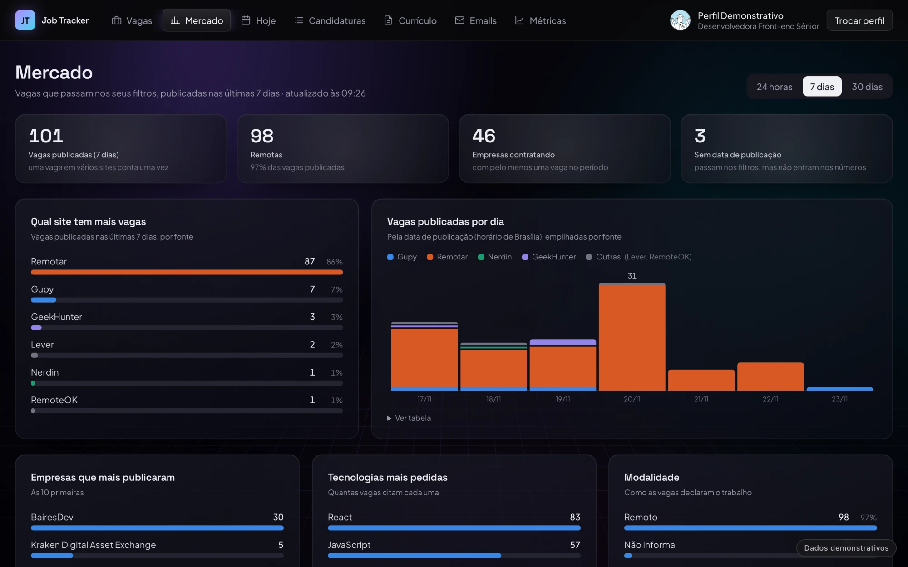
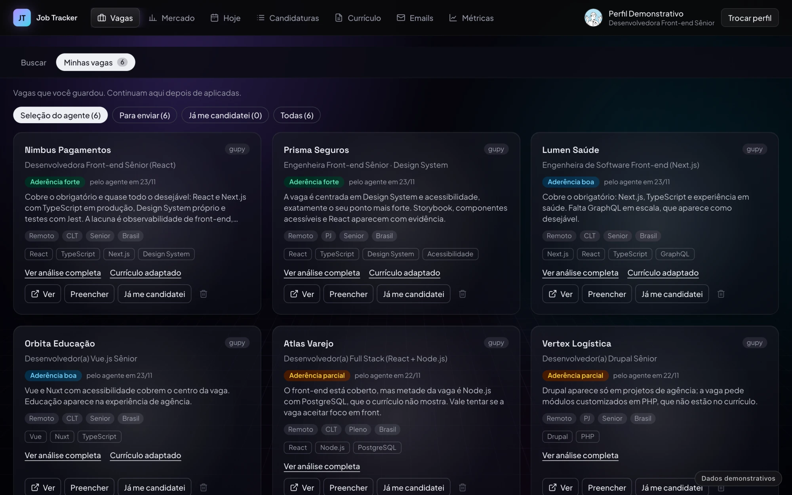
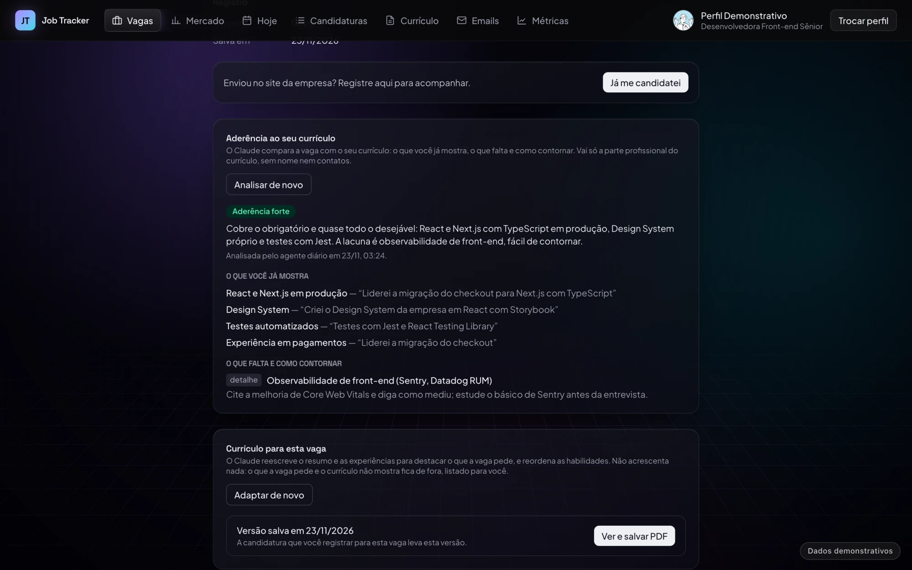
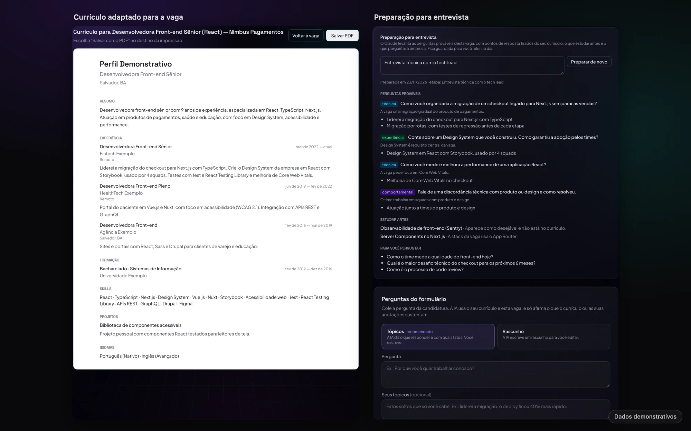
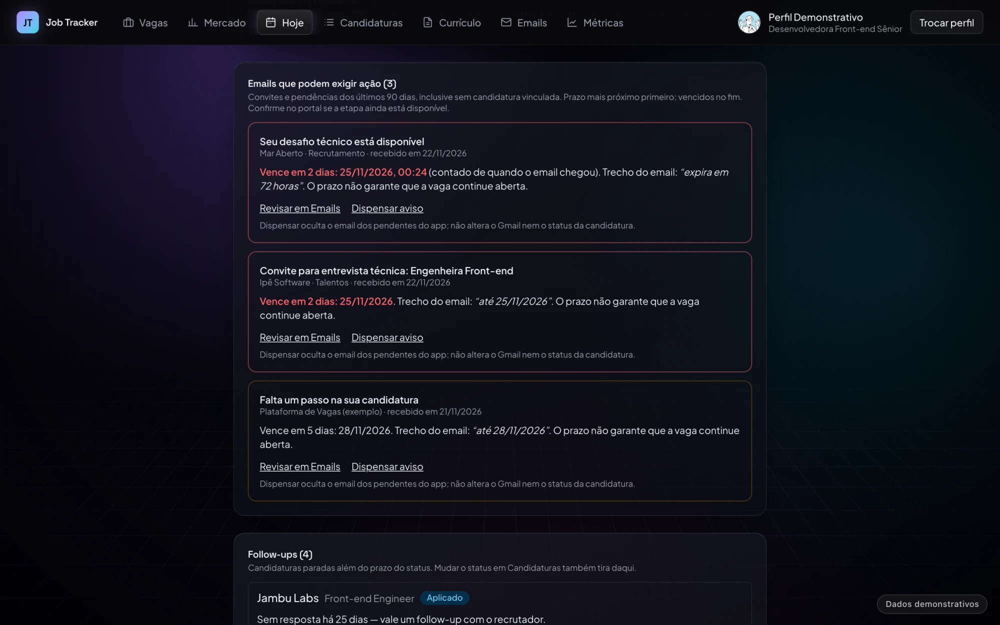
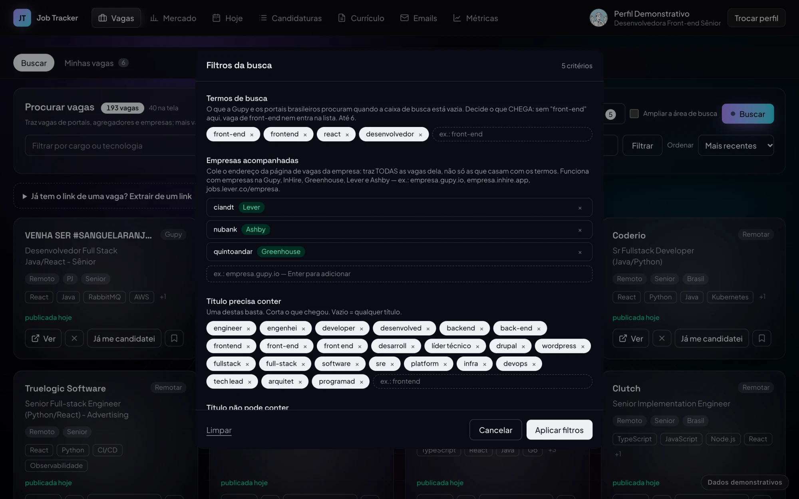
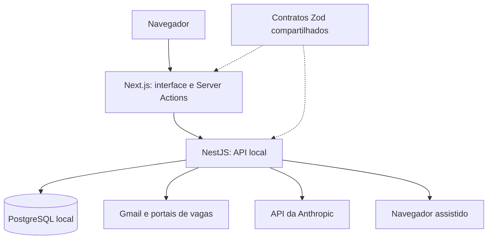

# Job Tracker

Organize sua busca de emprego em um só lugar: encontre vagas, registre
candidaturas, acompanhe respostas por email e veja quais fontes estão trazendo
resultado. A proposta é registrar uma candidatura ou mudar seu status em menos
de 30 segundos.

Aplicação pessoal, executada na sua máquina, com Next.js, NestJS e PostgreSQL.
As integrações com Gmail e Claude são opcionais.

> **Uso local, sem login.** Interface, API e banco usam `127.0.0.1`.
> Os perfis pertencem ao mesmo usuário; não são contas separadas.
> Publicar o código no GitHub não exige expor o aplicativo na internet.
> A aplicação não está preparada para hospedagem pública ou uso compartilhado.



[Instalação](#instalação) · [Funcionalidades](#funcionalidades) ·
[Arquitetura](#arquitetura) · [Guia de uso](docs/guia-de-uso.md)

## Como funciona

1. Crie um perfil e preencha ou importe seu currículo.
2. Configure os termos de busca e as empresas que deseja acompanhar.
3. Salve as vagas que interessam e registre as candidaturas enviadas.
4. Se conectar o Gmail, sincronize os emails dos processos seletivos.
5. Revise sugestões de status e acompanhe pendências e métricas.

A candidatura é enviada por você, no portal da empresa. O preenchimento
assistido para antes do envio. Sugestões de status por IA precisam de confirmação.

## Funcionalidades

| Área | O que oferece | Integração necessária |
| --- | --- | --- |
| Vagas | Busca em várias fontes, filtros, relevância por código, agrupamento de anúncios, salvar e descartar | Nenhuma; alertas do LinkedIn dependem do email |
| Mercado | Vagas por período, fonte, empresa, tecnologia e modalidade | Nenhuma |
| Candidaturas | Cadastro, status, histórico, notas e cópia do currículo registrado como enviado | Nenhuma |
| Currículo | Edição estruturada, importação do arquivo exportado pelo LinkedIn e impressão em PDF | Nenhuma; importação de PDF usa Claude |
| Hoje | Pendências de email, prazos e lembretes de follow-up | Gmail para os recursos de email |
| Emails | Leitura de um rótulo dedicado e vínculo com candidaturas | Gmail via IMAP |
| Métricas | Funil, tempo até a primeira resposta e aproveitamento por fonte | Nenhuma |
| Assistência por IA | Extração de vaga por link, sugestões de status, resolução de emails, aderência, currículo adaptado, preparação para entrevista e respostas de formulário | API da Anthropic, com crédito |
| Preenchimento assistido | Preenche campos reconhecidos em um navegador visível, sem enviar | Navegador Chromium |
| Agente diário | Procura vagas novas todo dia e as deixa na Seleção do agente, sem IA por padrão | Nenhuma por padrão; agendamento no macOS. A análise automática por IA é opcional (`--com-ia`) |

As fontes incluem Gupy, Remotar, Nerdin, GeekHunter, Programathor, Remotive,
Remote OK e boards de empresas. Empresas acompanhadas podem usar Gupy, InHire,
Greenhouse, Lever, Ashby ou Workday. O LinkedIn entra exclusivamente pelos
alertas recebidos por email: o app não acessa o site automaticamente.

A disponibilidade e a quantidade de resultados dependem de cada fonte e dos
filtros. A ordem de relevância da busca é calculada por código; a análise por
Claude compara uma vaga específica com seu currículo e histórico profissional.

### Telas

| | |
| --- | --- |
|  **Seleção do agente**: vagas que o agente encontrou, para você escolher quais analisar; as analisadas mostram veredito, resumo e currículo adaptado |  **Aderência**: o que você já mostra, o que falta e como contornar |
|  **Currículo adaptado e preparação para entrevista** |  **Hoje**: convites, testes e pendências com prazo, e follow-ups |
|  **Busca**: termos, empresas acompanhadas e filtros de título |  **Mercado**: vagas por fonte, dia, empresa e tecnologia |

As telas usam um perfil com dados demonstrativos. Veja [cada tela e seus comandos](docs/guia-de-uso.md#o-menu-tela-por-tela).

## Instalação

### Requisitos

- **Node.js 22.12 ou superior na linha 22**, recomendada pelo `.nvmrc`, e npm.
  Com nvm, execute `nvm use`. O Prisma instalado aceita Node `^20.19`,
  `^22.12` ou `>=24`; Node 20.9 não basta.
- **Docker com Docker Compose**, para o PostgreSQL.
- Opcional: Gmail com senha de app, chave da API da Anthropic e navegador
  Chromium para as integrações correspondentes.

### 1. Instale as dependências

Clone este repositório pelo endereço mostrado no botão **Code** do GitHub,
abra a pasta clonada e execute:

```bash
npm install
```

A instalação gera o cliente Prisma e compila `packages/shared`.

### 2. Crie os arquivos de configuração

Na raiz do projeto:

```bash
cp .env.example .env
cp recruiter-backend/.env.example recruiter-backend/.env
cp recruiter-frontend/.env.example recruiter-frontend/.env.local
```

| Arquivo | Configura |
| --- | --- |
| `.env` | Usuário, senha, nome e porta do Postgres no Docker |
| `recruiter-backend/.env` | Conexão com o banco e integrações opcionais |
| `recruiter-frontend/.env.local` | Endereço da API usado pelo servidor Next.js |

Os exemplos permitem iniciar sem Gmail e sem Claude. Não é necessário preencher
as variáveis dessas integrações para testar o cadastro e a busca de vagas.

### 3. Inicie o banco

```bash
npm run infra:up
```

Espere o Postgres ficar pronto; `docker compose ps` mostra o estado `healthy`.
Depois aplique as migrations:

```bash
npm run db:deploy
```

Opcionalmente, crie um perfil inicial com `npm run db:seed`. Também é possível
criar o perfil pela interface.

### 4. Inicie a aplicação

Em um terminal, execute a API:

```bash
npm run dev:worker
```

Em outro, execute a interface:

```bash
npm run dev:web
```

Abra [http://127.0.0.1:3000](http://127.0.0.1:3000).
A API usa [http://127.0.0.1:3333](http://127.0.0.1:3333).
Apesar do nome `dev:worker`, esse comando inicia o servidor NestJS.

Para encerrar, use `Ctrl+C` nos dois terminais e `npm run infra:down` para parar
o banco. O volume do Docker preserva os dados; remover esse volume apaga o banco.

## Integrações opcionais

Configure no `.env` do backend e reinicie a API:

| Integração | Variáveis principais | Instruções |
| --- | --- | --- |
| Claude | `ANTHROPIC_API_KEY` | [Modelos, contexto enviado e custos](docs/guia-de-uso.md#claude-anthropic) |
| Rebase Jobs | `REBASE_JOBS_TOKEN` | [Busca na Rebase Jobs](docs/guia-de-uso.md#rebase-jobs) |
| Gmail | `IMAP_HOST`, `IMAP_USER`, `IMAP_PASSWORD`, `IMAP_MAILBOX` | [Rótulo e senha de app](docs/guia-de-uso.md#email-gmail) |
| Boards de empresas | `DISCOVERY_GREENHOUSE_BOARDS`, `DISCOVERY_ASHBY_BOARDS`, `DISCOVERY_LEVER_BOARDS` | [Empresas acompanhadas](docs/guia-de-uso.md#empresas-acompanhadas-na-descoberta) |
| Navegador | `FORM_FILL_BROWSER_PATH`, se não for detectado | [Preenchimento assistido](docs/guia-de-uso.md#preenchimento-de-formulário) |

As chamadas ao Claude são cobradas pela Anthropic. A implementação usa Haiku
para extração e classificação, Sonnet para escrita e Opus para aderência.
A disponibilidade desses modelos depende da conta utilizada.

O [agente diário](docs/guia-de-uso.md#agente-diário) **não chama o Claude por
padrão**: ele busca, filtra e salva vagas sem nenhum custo, e você escolhe no
app quais analisar. A análise automática só roda com a opção explícita
`--com-ia`, e o currículo adaptado automático pede outra opção,
`--com-curriculo`. O `--teto` limita a **quantidade** de análises por execução,
não o valor em dinheiro. A triagem por título tem foco em front-end/web.

## Arquitetura

Monorepo TypeScript com npm workspaces:

| Diretório | Responsabilidade |
| --- | --- |
| `recruiter-frontend/` | Next.js 16, React 19, Tailwind CSS 4 e Motion; páginas e Server Actions |
| `recruiter-backend/` | NestJS 11; API, Prisma 7, descoberta, IMAP, Playwright e SDK da Anthropic |
| `packages/shared/` | Contratos e validações Zod 4 compartilhados pelos dois apps |
| `scripts/` | Agente de busca e instalação do agendamento no macOS |
| `recruiter-backend/prisma/` | Schema, migrations e seed do PostgreSQL 16 |
| `docs/` | Guia de uso, documentação complementar e capturas de tela |



O navegador da interface chama o Next.js; o servidor do Next chama a API.
Só o backend acessa banco e integrações. A API revalida as entradas com os
contratos compartilhados.

No modelo de dados, uma `Job` pode ser salva por vários perfis. `Application`
guarda a candidatura; `StatusEvent`, as mudanças de etapa e quando ocorreram.
O funil usa o histórico, e candidaturas excluídas ficam fora das métricas.
`ResumeVersion` guarda uma cópia do conteúdo para preservar o currículo
registrado na candidatura mesmo após editar o currículo base.

## Segurança e privacidade

- API, interface e Postgres são configurados para escutar somente em loopback.
  API e interface verificam o `Host`; escritas na API exigem JSON.
- Não há autenticação nem isolamento entre pessoas. Mantenha o uso local.
- Credenciais ficam nos `.env`, ignorados pelo Git. A senha de exemplo do banco
  destina-se à configuração local.
- Os emails são lidos de um rótulo dedicado, em modo somente leitura. O vínculo
  automático e o uso de IA exigem verificação do remetente. O **Resolver por IA**
  também pode enviar emails pendentes verificados para propor vínculos.
- O contexto profissional enviado ao Claude não inclui os campos de identificação
  do perfil. Anotações e histórico são campos livres e também podem ser enviados;
  evite inserir dados pessoais neles. O texto importado de PDF passa por remoção
  de dados pessoais antes da extração por IA, sem garantia de anonimização completa.
- Conteúdo de vagas e emails é tratado como dado de terceiros. As respostas da IA
  são estruturadas e validadas, mas precisam de revisão humana.
- Formulários nunca são enviados automaticamente. O contrato declara
  `submitted: false`.

Dados do banco, sessões do navegador, logs e exportações pessoais não devem
ser incluídos em commits ou anexados a issues.

## Desenvolvimento

```bash
npm run build:shared                 # recompila os contratos
npm run build                        # compila os três pacotes
npm test -w recruiter-backend         # testes unitários da API
npm run lint                         # atenção: o lint do backend aplica --fix
npm run db:migrate                   # gera migration após alterar o schema
npm run db:studio                    # abre o Prisma Studio
```

Depois de alterar `packages/shared`, recompile o pacote e reinicie a API.
Durante o desenvolvimento, use `IMAP_SYNC_ON_BOOT=false` para evitar
sincronização de emails a cada reinício do modo watch.

Consulte o [guia de problemas comuns](docs/guia-de-uso.md#problemas-comuns)
e os READMEs do [backend](recruiter-backend/README.md) e do
[frontend](recruiter-frontend/README.md).

## Licença

O repositório ainda não inclui um arquivo `LICENSE`; o backend declara
`UNLICENSED`. A licença para contribuições e reutilização ainda precisa ser definida.
