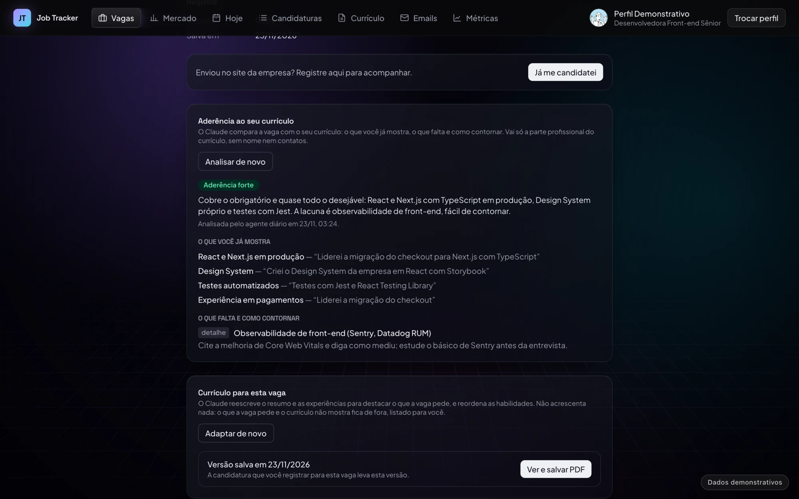
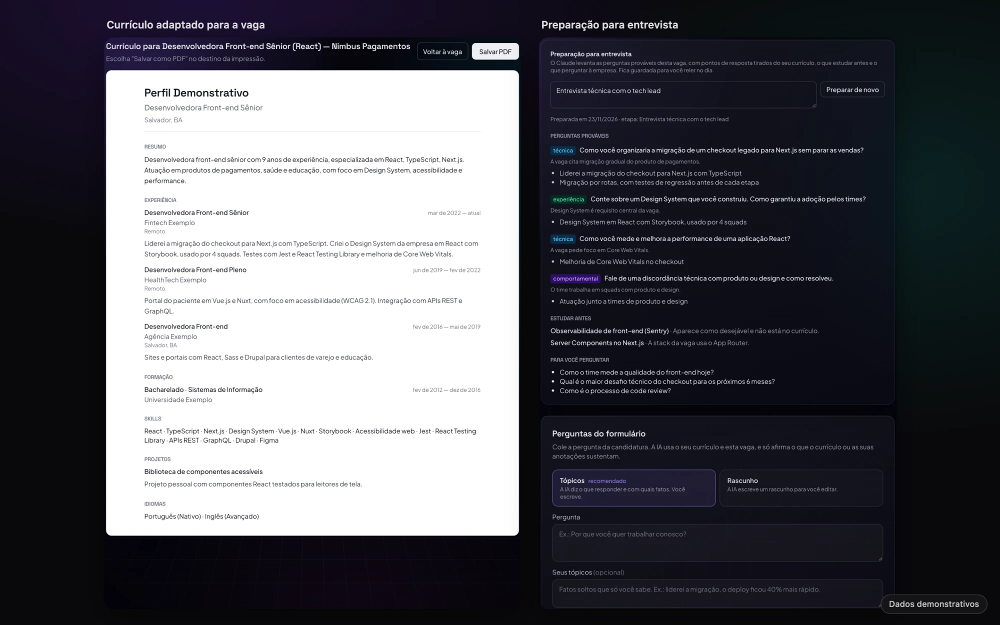
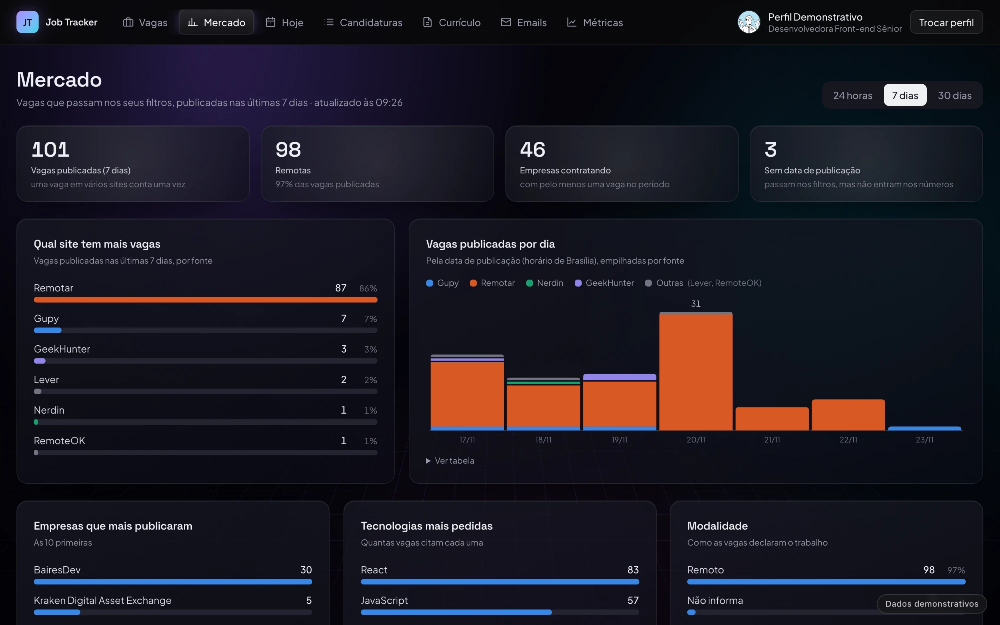

# Guia de uso e configuração

Este guia detalha as telas, as integrações opcionais e o agente diário.
Para instalar o projeto, consulte o [README](../README.md).

- [Telas](#o-menu-tela-por-tela)
- [Integrações](#configuração-opcional)
- [Agente diário](#agente-diário)
- [Problemas comuns](#problemas-comuns)

## O menu, tela por tela

O menu do topo tem sete itens. À direita fica o perfil escolhido e o botão
**Trocar perfil**. Os itens marcados com 🔑 usam a API da Anthropic e precisam
da chave; os demais recursos não dependem dela.

### Vagas

Onde você encontra vagas e decide o que fazer com cada uma. Tem duas abas,
fixas no topo ao rolar: **Buscar** e **Minhas vagas**.


**Buscar** junta numa lista só as vagas de todas as fontes: portais (Gupy,
Remotar, Nerdin, GeekHunter, Programathor e outros), empresas acompanhadas e
alertas do LinkedIn que chegam por email.

- **Buscar** consulta as fontes de novo. O contador ao lado do título diz
  quantas vagas passaram nos seus filtros e quantas estão na tela; mais vagas
  chegam conforme você rola.
- **Ampliar a área de busca** liga também as fontes lentas, que leem o portal
  página a página. Leva alguns segundos a mais.
- **Filtrar por cargo ou tecnologia** restringe a busca ao texto digitado. A
  tela avisa enquanto ele estiver ativo, com um *limpar* ao lado.
- **Ordenar**: mais recentes (o padrão: vaga nova tem menos concorrência),
  relevância para o seu currículo, empresa ou cargo.
- **Já tem o link de uma vaga? Extrair de um link** 🔑: cole o endereço e o
  Claude lê a página e preenche a vaga para você revisar e salvar.
- Clique no **nome da empresa** num card para ver só as vagas dela. Anúncios
  repetidos da mesma vaga em sites diferentes viram um card só, com a contagem
  de "anúncios iguais".

Cada card tem quatro botões:

| Botão | O que faz |
| --- | --- |
| **Ver** | Abre a vaga no site de origem |
| **✕** | Descarta a vaga: ela some da busca deste perfil, com *desfazer* |
| **Já me candidatei** | Salva a vaga e registra a candidatura como enviada, com a data de hoje |
| **Salvar** (marcador) | Guarda a vaga em *Minhas vagas* para decidir depois |

**Filtros** abre o modal com o que decide quais vagas chegam:


- **Termos de busca**: o que os portais procuram (até 6). Sem "front-end"
  aqui, vaga de front-end nem entra na lista.
- **Empresas acompanhadas**: cole o endereço da página de vagas da empresa e
  todas as vagas dela entram, não só as que casam com os termos. A
  plataforma é reconhecida na hora (veja [a tabela](#empresas-acompanhadas-na-descoberta)).
- **Título precisa conter** e **Título não pode conter**: palavras exigidas
  ou proibidas no título da vaga.
- **Localização** (Brasil ou internacional), **Estado**, **Modalidade**,
  **Contrato**, **Senioridade** e **Tecnologias**.
- **Vagas do LinkedIn**: a idade máxima dos alertas. O alerta não diz se a
  vaga ainda aceita candidatura, então as velhas ficam de fora.

**Minhas vagas** são as vagas que você salvou (ou que o
[agente diário](#agente-diário) salvou para você). Elas continuam aqui depois
de aplicadas. Os filtros do topo separam a lista:

| Filtro | O que mostra |
| --- | --- |
| **Seleção do agente** | O que o agente analisou e você ainda não enviou, da melhor aderência para a pior |
| **Para enviar** | Vagas salvas sem candidatura registrada |
| **Já me candidatei** | Vagas com candidatura registrada |
| **Todas** | Tudo o que está salvo |


O card mostra a aderência e o resumo da análise, quando houver, com os links
**Ver análise completa** e **Currículo adaptado**. Os botões:

| Botão | O que faz |
| --- | --- |
| **Ver** | Abre a vaga no site da empresa |
| **Preencher** | Abre a vaga num navegador e preenche nome, email, telefone e links. **Nunca envia**: você revisa, anexa o currículo e clica em enviar |
| **Já me candidatei** | Registra a candidatura depois que você enviou no site. Vira **Acompanhar candidatura** |
| **Lixeira** | Remove a vaga de *Minhas vagas* (pede confirmação) |

**Página da vaga.** Clique no nome da empresa ou do cargo num card de *Minhas
vagas* para abrir a página da vaga no app. Ela tem os detalhes da vaga, a
barra **Já me candidatei** (ou o status da candidatura, se já existir) e
quatro painéis. Na interface, cada painel chama o Claude quando você solicita. O agente diário
também pode executar análises e adaptações. O contexto inclui o currículo
profissional e, quando preenchido, o histórico profissional.





- **Aderência ao seu currículo** 🔑: o veredito (forte, boa, parcial ou
  fraca), o que você já mostra, com o trecho do currículo que prova, e o que
  falta, com como contornar. Trecho que o servidor não acha no currículo vem
  marcado como *confira*. A análise fica guardada: ao voltar à página ela já
  está lá, e **Analisar de novo** substitui. É a chamada mais cara do app.
- **Currículo para esta vaga** 🔑: **Adaptar** reescreve o resumo e as
  experiências para destacar o que a vaga pede e reordena as habilidades. A proposta deve se apoiar no currículo e no histórico profissional; o que
  a vaga pede e esses registros não mostram fica listado à parte. As verificações
  automáticas ajudam na revisão, mas não garantem que toda afirmação esteja correta. Revise e use **Salvar esta versão**; **Ver e salvar PDF** abre a
  versão para imprimir. É essa versão que fica registrada como o currículo
  enviado quando você marca a candidatura.
- **Preparação para entrevista** 🔑: conte como é a etapa (opcional, ex.:
  "técnica com o tech lead") e clique em **Preparar**. Vêm as perguntas
  prováveis com pontos de resposta tirados do seu currículo, o que estudar
  antes e o que perguntar à empresa. Fica guardada para você reler no dia.
- **Perguntas do formulário** 🔑: cole uma pergunta aberta da candidatura
  ("Por que você quer trabalhar conosco?"). Em **Tópicos** (recomendado) o
  Claude diz o que responder e com quais fatos, e você escreve; em
  **Rascunho** ele escreve um texto para você editar. Dá para escolher
  português, inglês ou espanhol e pedir uma versão curta. O servidor confere
  a resposta sem IA e aponta números que não estão no currículo, afirmações
  sem trecho correspondente, o que a vaga pede e você não mostra, expressões
  com cara de texto de IA e respostas acima do limite.

### Mercado

A página inicial. Responde "como está o mercado nos meus filtros?" antes de
qualquer clique, sem IA.



- **Período**: últimas 24 horas, 7 dias ou 30 dias.
- Totais: **vagas publicadas** (uma vaga em vários sites conta uma vez),
  **remotas**, **empresas contratando** e **sem data de publicação** (passam
  nos filtros, mas ficam fora dos números).
- **Qual site tem mais vagas**: vagas por fonte.
- **Vagas publicadas por dia**: empilhadas por fonte, pelo horário de
  Brasília. **Ver tabela** mostra os números.
- **Empresas que mais publicaram** (as 10 primeiras), **Tecnologias mais
  pedidas** e **Modalidade**.

Use para decidir o que estudar (as tecnologias mais pedidas) e onde procurar
(as fontes e empresas com mais vagas).

### Hoje

O que pede ação hoje, numa tela só:


- **Emails**: o estado da leitura do Gmail (última sincronização, rodada em
  andamento ou com falha) e o botão **Sincronizar agora**. Com os dados
  desatualizados, a tela não diz "sem pendências".
- **Emails que podem exigir ação**: convites para entrevista, etapas de teste
  e candidaturas incompletas, com o prazo quando o email diz um. Prazo
  próximo vem primeiro. **Abrir email** leva ao Gmail; dispensar tira o aviso
  da lista, com *desfazer*. Detalhes em
  [docs/email-action-alerts.md](email-action-alerts.md).
- **Follow-ups**: candidaturas paradas há tempo demais no mesmo status. Marque
  que fez o follow-up ou adie o lembrete.
- **Emails com sugestão de status** 🔑: o Claude leu um email e sugere mudar o
  status de uma candidatura. Confirme em *Candidaturas*.
- **Candidaturas por status** e um atalho para as vagas salvas que esperam
  candidatura.
- **Confira também os emails fora do filtro**: aparece se você configurou
  `RECRUITING_RESCUE_SENDERS`, e abre essa busca no Gmail.

### Candidaturas

Todas as candidaturas do perfil, com o status de cada uma.

- **Registrar candidatura**: empresa, cargo, link, status, notas,
  senioridade, modalidade, local e a data em que foi registrada.
- **Buscar e filtrar**: por texto, pelo período de cadastro (7, 30 ou 90 dias,
  ou um período seu) e pela ordem (mais recentes, mais antigas, mais
  avançadas no funil ou começo do funil).
- **Mudar status**: rascunho, aplicado, triagem, entrevista, teste, oferta,
  rejeitado ou cancelado. Cada mudança entra no **Histórico** da candidatura,
  com **quando aconteceu** (que pode ser diferente de quando você registrou)
  e a origem: você, um email ou uma sugestão de IA confirmada. **Ler o email**
  abre o email que motivou a mudança.
- **Sugestão de status a partir de um email** 🔑: quando o Claude lê uma
  resposta da empresa, a sugestão aparece no card com o motivo. Nada muda
  sem o seu clique.
- **Ver detalhes**, **Editar** e **Excluir**. Candidatura excluída some da
  lista e das métricas.
- **Responder perguntas do formulário** 🔑: o mesmo painel da página da vaga.

### Currículo

O seu currículo estruturado, de onde saem o PDF, as análises e as respostas.

- **Importar currículo (PDF)** 🔑: o texto é extraído na sua máquina e perde
  nome, contatos e documentos antes de ir ao Claude, que preenche o
  formulário para você revisar. Também dá para importar o **arquivo de dados
  do LinkedIn**, sem IA.
- **Dados pessoais**, **Resumo**, **Experiências**, **Formação**,
  **Competências**, **Projetos**, **Idiomas** e **Certificações**. Nada é
  gravado até você clicar em **Salvar**.
- **Histórico profissional**: fatos verdadeiros da sua trajetória que não
  couberam no currículo, e a lista do que você **não** quer mostrar. As
  análises e respostas usam o histórico como prova, e nunca sugerem o que
  está na lista de excluídos.
- **Ver e salvar PDF**: abre o currículo pronto para imprimir em PDF pelo
  navegador.

### Emails

Os emails do rótulo do Gmail que ainda não estão ligados a uma candidatura.

- **Sincronizar agora**: lê os emails novos do rótulo.
- Em cada email: **Registrar candidatura** a partir dele, vincular a uma
  candidatura existente ou **Remover da lista** (com *desfazer*; o Gmail não
  é alterado).
- **Resolver por IA** 🔑: selecione vários emails e o Claude propõe um plano
  (criar candidaturas, vincular a existentes, ignorar). Você revisa o plano e
  aplica, ou **Descarta plano**. Só vão ao Claude emails com remetente
  verificado.

### Métricas

O que aconteceu depois que você se candidatou, calculado a partir do
histórico, sem IA.

- Totais: **ativas**, **responderam**, **rejeitadas**, **em rascunho**,
  **vagas recebidas**, **salvas**, **dispensadas** e **emails**.
- **Funil**: quantas candidaturas chegaram a cada etapa. Conta quem já passou
  pela etapa, não só quem está nela agora.
- **Tempo até a primeira resposta**, **Emails por dia** e **Vagas recebidas
  por dia**.
- **O que cada fonte rendeu** e **De onde vieram suas candidaturas**: qual
  site trouxe vagas que você aproveitou.

Com poucas candidaturas, as taxas de conversão ficam ocultas em vez de mostrar
uma porcentagem sobre quatro casos.

## Configuração opcional

Tudo abaixo fica em `recruiter-backend/.env`. Depois de mudar o arquivo,
reinicie a API.

### Claude (Anthropic)

```env
ANTHROPIC_API_KEY=sua-chave
```

A chave precisa de crédito: sem saldo, a API responde erro e a tela avisa.

O app só chama o Claude quando você pede (um clique, uma seleção), ao
sincronizar emails já vinculados a uma candidatura, ou quando o
[agente diário](#agente-diário) roda. Cada função usa o modelo que cabe nela:

| Função | Modelo | Custo relativo |
| --- | --- | --- |
| Ler vaga por link, email, currículo em PDF; sugerir status; Resolver por IA | Haiku | baixo |
| Currículo adaptado, preparação para entrevista, perguntas do formulário | Sonnet | médio |
| Aderência entre a vaga e o currículo | Opus | alto |

A aderência usa o modelo de maior custo relativo e o currículo inteiro.
O agente diário pode executar dezenas de análises em uma rodada.
Acompanhe o consumo no [console da Anthropic](https://console.anthropic.com/).
Algumas funções têm limites locais de chamadas por minuto. Esses limites
não são um orçamento financeiro nem impedem gastos em novas execuções.

O que sai da sua máquina:

- **Emails:** a classificação usa emails vinculados e com remetente verificado.
  No **Resolver por IA**, emails pendentes verificados também são enviados para
  propor o vínculo ou uma nova candidatura. O app não envia a caixa inteira.
- **Currículo:** a parte profissional, sem os campos de identificação do perfil.
  O histórico profissional e as anotações também podem compor o contexto;
  evite colocar dados pessoais nesses campos livres. Na importação de PDF, o texto
  é extraído na sua máquina e passa por remoção de dados pessoais antes de ir ao
  Claude. Essa remoção não garante anonimização completa; email, telefone e links preenchem o perfil direto. A cidade
  fica, para a busca achar vagas locais.
- **Vagas:** o texto da vaga que você está usando.

As respostas de formulário vêm, por padrão, como tópicos para você escrever
com suas palavras. Revise também os rascunhos e currículos adaptados antes de usar.

### Email (Gmail)

A leitura usa um **rótulo** do Gmail, nunca a caixa de entrada inteira: o
próprio Gmail garante esse limite antes de o app ver qualquer email.

1. Ative a verificação em duas etapas na conta Google.
2. Gere uma **senha de app** em [Senhas de app do Google](https://myaccount.google.com/apppasswords). Nunca use
   a senha principal da conta.
3. Crie o rótulo `job-tracker` e, em *Configurações → Marcadores*, marque
   **Mostrar no IMAP**. Sem isso o rótulo existe na web e fica invisível para
   o app.
4. Crie um filtro que aplique esse rótulo aos emails das plataformas de
   recrutamento. Use o domínio de onde o email **sai**, que nem sempre é o do
   site: a Gupy envia de `gupy.com.br`, o Greenhouse de `greenhouse-mail.io`,
   a InHire de `inhire.app`. Inclua `jobalerts-noreply@linkedin.com` para os
   alertas de vaga do LinkedIn entrarem na descoberta. Na dúvida, abra um
   email da plataforma e veja o remetente. Ao salvar, marque *Aplicar filtro
   também às conversas correspondentes*.
5. Preencha no `.env`:

   ```env
   IMAP_HOST=imap.gmail.com
   IMAP_USER=seu-email@gmail.com
   IMAP_PASSWORD=a-senha-de-app
   ```

A sincronização roda uma vez quando a API sobe e, depois disso, só quando você
clica em **Sincronizar agora** na tela *Emails*. Para trazer emails mais
antigos que o último sincronizado (depois de ampliar o filtro, por exemplo):

```bash
curl -X POST -H 'Content-Type: application/json' \
  'http://127.0.0.1:3333/emails/sync?days=45'
```

### Empresas acompanhadas na descoberta

A busca por portais só acha o que casa com os seus termos. Para trazer
**todas** as vagas de uma empresa, cole o endereço da página de vagas dela em
*Vagas → Filtros → Empresas acompanhadas*. A plataforma é reconhecida pelo
endereço, e a tela mostra na hora se reconheceu:

| Plataforma | Exemplo de endereço |
| --- | --- |
| Gupy | `empresa.gupy.io` |
| InHire | `empresa.inhire.app` |
| Greenhouse | `boards.greenhouse.io/empresa` |
| Lever | `jobs.lever.co/empresa` |
| Ashby | `jobs.ashbyhq.com/empresa` |
| Workday | `empresa.wd5.myworkdayjobs.com/SiteDeVagas` |

Muitas empresas não têm sistema de vagas próprio: a página "Vagas" do site
mostra vagas hospedadas numa dessas plataformas. Abra uma vaga no site da
empresa e veja para onde o link aponta. O site da CI&T, por exemplo, já é
reconhecido e lido pela Lever dela.

Na Workday, onde ficam empresas grandes como a Accenture, o app lê só as vagas
do Brasil e só a lista: sem descrição, porque a Workday bloqueia por alguns
minutos quem faz muitas consultas seguidas. Empresas em SuccessFactors ou
Oracle não são lidas.

Também dá para fixar boards no `.env`, valendo para todos os perfis. Liste os
slugs, separados por vírgula:

```env
DISCOVERY_GREENHOUSE_BOARDS=empresa-um,empresa-dois
DISCOVERY_ASHBY_BOARDS=
DISCOVERY_LEVER_BOARDS=
```

O slug é a parte do endereço do board: `boards.greenhouse.io/<slug>`,
`jobs.ashbyhq.com/<slug>`, `jobs.lever.co/<slug>`. Slug errado não dá erro, a
empresa só não aparece; confira abrindo o endereço no navegador. Prefira
empresas com vagas remotas ou no Brasil: um board com centenas de vagas
presenciais no exterior enche a fila com o que você não procura.

### Preenchimento de formulário

Usa um navegador baseado em Chromium já instalado na máquina, nesta ordem:

1. o caminho em `FORM_FILL_BROWSER_PATH`, se você informar;
2. o seu navegador padrão (macOS, Linux ou Windows), se for Chrome, Brave,
   Edge, Chromium ou Vivaldi;
3. o primeiro desses que estiver instalado no lugar padrão;
4. o Chromium do próprio Playwright, se você o instalou.

```env
FORM_FILL_BROWSER_PATH=/caminho/para/o/navegador
```

Firefox e Safari não servem: o Playwright não controla as versões
instaladas deles. Se você só tem um deles, instale o Chromium do Playwright
(é um download grande, que fica fora da pasta do projeto):

```bash
cd recruiter-backend
npx playwright-core install chromium
```

O navegador abre com um perfil próprio, guardado em
`~/.local/share/job-tracker/`, fora da pasta do projeto: suas abas e logins
do dia a dia não são tocados. Se a plataforma
pedir login, faça pelo próprio navegador que abrir; a sessão fica salva nesse
perfil. O app preenche nome, email, telefone e links, deixa em branco o que não
reconhece e **nunca envia**: você revisa e clica em enviar.

## Agente diário

Um script que roda sozinho todo dia, procura vagas boas para você e deixa o
resultado dentro do app, em *Vagas → Minhas vagas → Seleção do agente*. Precisa
da chave da Anthropic e tem agendamento e notificações implementados para macOS (`launchd` e
`osascript`). A triagem por título está voltada a front-end e desenvolvimento web;
essa regra fica no script, não nos filtros configuráveis do perfil.

O que ele faz, nesta ordem:

1. Lê a busca inteira da API local, das vagas mais novas para as mais antigas
   (até 21 dias), com os filtros do seu perfil.
2. Descarta de graça, pelo título, o que é claramente de outra trilha
   (back-end em outra linguagem, infraestrutura, dados, QA, mobile nativo).
   Se o título também falar de front-end, a vaga fica.
3. Salva e analisa a aderência de cada vaga, uma a uma, até achar a meta de
   vagas **forte** ou **boa**, ou até bater o teto de análises da execução.
4. Para as vagas forte ou boa, gera e salva o currículo adaptado.
5. Avisa por notificação do Mac quantas vagas analisou e quantos emails pedem
   ação.

O que ele **nunca** faz: candidatar, enviar formulário, descartar vaga, mudar
status de candidatura ou acessar o LinkedIn. Ele prepara; quem envia é você.

Ele registra URLs analisadas no estado local ao terminar a execução. Esse
registro não é separado por perfil. O teto reinicia a cada execução e não inclui
o custo das adaptações de currículo; não é um limite diário de gastos.
Em geral, a primeira execução tem mais vagas pendentes; nas seguintes,
URLs já registradas no estado local são ignoradas. Se o crédito acabar ou a chave for
recusada durante a análise de aderência, ele interrompe a rodada. Vaga sem descrição é pulada sem gastar análise.

Para agendar (exemplo: às 9h, meta de 10 vagas boas, no máximo 60 análises por execução):

```bash
scripts/instalar-agente-diario.sh 9 10 60
```

Para rodar agora, sem esperar o horário:

```bash
node scripts/agente-diario.mjs --top 10 --teto 60
```

| Opção | O que faz |
| --- | --- |
| `--top N` | Meta: quantas vagas forte ou boa encontrar (até 50) |
| `--teto N` | Máximo de tentativas de análise por execução (até 500, padrão 60) |
| `--sem-curriculo` | Analisa, mas não gera currículo adaptado |
| `--sem-analise` | Só lista as vagas da triagem, sem chamar o Claude |
| `--sem-aviso` | Não mostra a notificação |

**Mantenha o Postgres e a API em execução ao usar o agente.** O script tenta
iniciar a API quando ela está parada, mas esse caminho não carrega explicitamente
o `.env` do backend; não conte com ele numa instalação feita apenas com os
passos do README. Iniciar a API também pode disparar a sincronização de emails
e chamadas de classificação, mesmo com `--sem-analise`; para evitar isso, use
`IMAP_SYNC_ON_BOOT=false`. O log e a memória do agente ficam em `~/agente-vagas`, fora do projeto. Para tirar o
agendamento: `scripts/instalar-agente-diario.sh --remover`.

## Problemas comuns

<details>
<summary>Abrir a lista</summary>

**A porta 5432 já está em uso.** Outro Postgres está rodando na máquina. Mude
`POSTGRES_PORT` no `.env` da raiz e a porta do `DATABASE_URL` em
`recruiter-backend/.env`.

**A tela abre, mas nada carrega.** A API não está rodando, ou o `API_URL` em
`recruiter-frontend/.env.local` não aponta para ela. Use
`http://127.0.0.1:3333`, e não `localhost`: a API escuta só em IPv4.

**"Este app só atende em 127.0.0.1 ou localhost".** Você abriu o app por
outro endereço, como o IP da máquina na rede. É a proteção descrita
em [Segurança](../README.md#segurança-e-privacidade); abra por `http://127.0.0.1:3000`.

**O rótulo do Gmail não é encontrado.** Falta marcar *Mostrar no IMAP* nas
configurações de marcadores, ou o nome em `IMAP_MAILBOX` não é igual ao do
rótulo.

**O build falha ao baixar fontes.** O frontend usa `next/font/google` e
precisa acessar o Google Fonts durante o build. Verifique a conexão e as
configurações de proxy; o build não é totalmente offline.

**Node incompatível.** Use a versão indicada por `nvm use` (Node 22.12+ na
linha 22). O requisito do Prisma é mais restrito que o do Next.js.

**A IA responde "sem crédito".** A chave existe, mas a conta da Anthropic está
sem saldo. Adicione créditos em `console.anthropic.com`.

**"Importação indisponível: defina ANTHROPIC_API_KEY".** A linha existe no
`recruiter-backend/.env`, mas está vazia. Preencha com a chave (`sk-ant-...`,
sem aspas) e reinicie a API: o `.env` só é lido quando ela sobe.

**O `npm install` falha com E401.** O seu `~/.npmrc` global aponta para um
registry privado (de um trabalho anterior, por exemplo) com credencial
vencida. Instale pelo registry público, sem mexer no arquivo:
`npm install --registry=https://registry.npmjs.org/`.

**A busca trouxe bem menos vagas que antes.** Veja se há texto na caixa
*Filtrar por cargo ou tecnologia*: com texto, os portais procuram só ele, e a
vaga precisa ter a palavra no título. A tela mostra "Filtrando por …" com um
*limpar* ao lado. Sem texto, confira os termos de busca e o filtro de título
em *Filtros*.

**"O PDF quase não tem texto".** O currículo é uma imagem escaneada, sem
texto selecionável. Exporte de novo pelo editor (Word, Google Docs, Canva).

</details>
